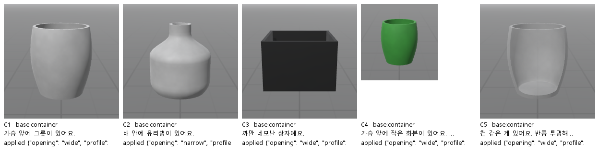
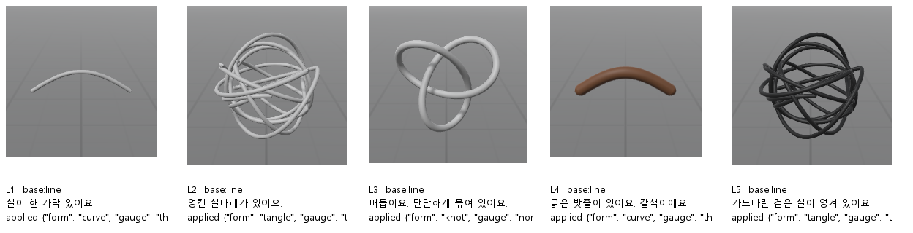
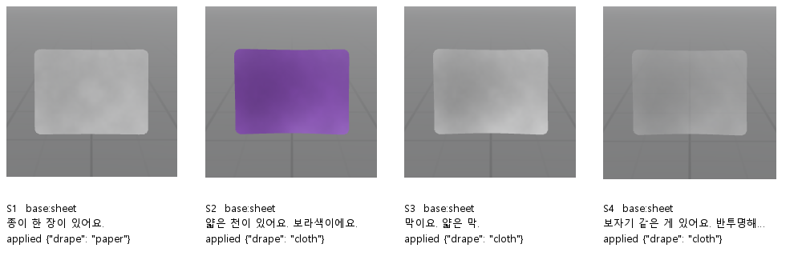
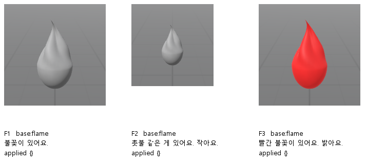
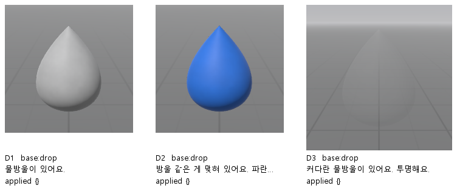

# 기본 형상 첫 묶음(D6) 검증 — 형상별 시트와 목업 전후 비교

- 날짜: 2026-11-23. 결정 G21·G22·G30, 계획 `docs/asset-plan.md`(첫 묶음 승인).
- 모든 문장은 연구자가 만든 합성 대사입니다(AGENTS.md 6). held-out 코퍼스는 쓰지 않았습니다(dev·목업만, G24).
- 그림 판정은 **AI(이 작업을 한 에이전트)가 캡처를 직접 열어 본 것**입니다. 팀원 판정과 헤드셋 확인은 하지 않았습니다.

## 1. 무엇을 했나

1. 형상별 합성 문장 20개(`make_specs.py`의 `SHAPES`)를 매퍼 v2(builder 2.2.0, 기본 형상 사전 0.5.0)로 spec을 만들고 배치 캡처했습니다.
2. 목업 36개 가운데 기본 형상과 닿는 14개(실·천·종이·상자·물방울·불꽃, 그리고 그려지면 안 되는 웅덩이·액체·빛·사람)를 D6 전 매퍼(builder 2.1.0, 커밋 `08473d9`의 깨끗한 작업 폴더)와 D6 뒤 매퍼로 각각 만들어 같은 Unity로 캡처했습니다.
3. 캡처 설정: 눈당 1032 × 1104(Quest 3 해상도의 절반), 한 눈, MSAA 4×, 준비 2 + 10프레임, PNG 폭 768. `visiblePixels`는 이 해상도 기준입니다(기존 시트의 2064 × 2208과 직접 비교하지 않음).

| 파일 | 내용 |
| --- | --- |
| `sheets/<형상>.png` | 형상별 시트(형상 주변 확대) |
| `sheets/mock-before.png` · `sheets/mock-after.png` | 목업 14개 전후 |
| `summary.<묶음>.json` | 렌더 경로, 계획 JSON의 `base`(규칙·변형값·기본값으로 채운 키·매개변수), `visiblePixels`, 윤곽 지표(X72), 대비, 콘솔 오류·경고 수, 메시 삼각형 수 |
| `capture/*_detail.png` | 원본 확대 PNG(장면 전체 PNG는 크기 때문에 넣지 않음) |

## 2. 형상별

| 형상(규칙) | 메시 | 변형 | 삼각형 | 시트 |
| --- | --- | --- | --- | --- |
| 담는 것 `container/1` | 벽 두께 0.04의 닫힌 회전체(바깥·안쪽 옆면, 테두리 띠, 바닥 둘). 높이 1·최대 지름 0.9 | 입구 wide(테두리 = 몸통의 0.9배) / narrow(어깨에서 좁아져 목 = 0.35배), 단면 round(둘레 32) / square(둘레 4, 곧은 벽, 높이 0.7, 뚜껑 없는 열린 통) | 2,816 / 네모 32 |  |
| 선·끈 `line/1` | 곡선을 따라가는 관(둘레 8, 평행 이동 틀), 열린 곡선은 반구로 닫음 | 모양 curve(한 번 휜 열린 곡선) / tangle(공 모양으로 7바퀴 감긴 곡선) / knot(닫힌 세잎 매듭, 꼬리 없음), 굵기 thin 0.02 / normal 0.035 / thick 0.06 | 1,600 / 5,024 / 3,072 |  |
| 얇은 판 `sheet/1` | 1 × 0.75 둥근 모서리 판(24 × 18칸), 두께 0.01, 저주파 물결, 위쪽이 뒤로 15° | drape paper(물결 0.03) / cloth(0.06, 아래쪽이 더 늘어짐) | 1,896 |  |
| 불꽃 `flame/1` | 회전체: 아래 35%는 반원, 위는 오목하게 가늘어지는 혀(높이 2 : 폭 1), 세 갈래 꼬임(단면 × (1 + 0.35 cos(3θ + …))), 혀가 S자로 흔들리고 꼭짓점이 휨 | 없음 | 2,048 |  |
| 물방울 `drop/1` | 회전체: 반지름 sin θ · sin(θ/2), 아래 둥글고 위가 한 점(약 1.3 : 1) | 없음 | 1,536 |  |

모든 형상: 경계 상자 가장 긴 변 1·가운데 원점, 삼각형 5,120 이하, 닫힌 메시(모든 모서리를 삼각형 둘이 나눔), 면 방향이 정점 법선과 같음, 넓이 0 삼각형 없음, 같은 변형값·seed → 같은 메시(기본 변형값 메시 해시를 규칙 버전에 묶어 고정) — `unity/Assets/IFS/Tests/Editor/BaseShapeTests.cs`. 셰이더는 기존 IFS 불투명/반투명 셰이더(모양 모형과 같은 프리셋, 정점 변위 0)이고, 지오메트리 셰이더·컴퓨트를 쓰지 않아 WebGL2에서도 같은 코드입니다(WebGL 빌드에서 직접 돌려 보지는 않음, G35 대기).

### 그림을 본 판정(AI, 솔직하게)

| 형상 | 그 형상으로 읽히나 | 메모 |
| --- | --- | --- |
| 담는 것 | **부분적** | 병(C2)·반투명 컵(C5)·열린 상자(C3)는 잘 읽힘. "그릇"(C1)은 높이 1 : 지름 0.9라 사발보다 **컵·화분처럼 키가 큼**. 상자는 눈높이에서 보면 테두리만 조금 보여 정면에서는 검은 네모(큐브)와 비슷하다 |
| 선·끈 | **그렇다**(curve·knot), **부분적**(tangle) | 한 번 휜 선(L1·L4)과 세잎 매듭(L3)은 뚜렷함. 엉킨 실(L2·L5)은 공 모양으로 감긴 철사·털실 공으로 읽히고, 처음 안(구 안 무작위 걸음)은 성긴 낙서처럼 보여 바꿨다. 가는 선(thin)은 이 해상도에서 덮는 화소 947개(L1) |
| 얇은 판 | **부분적** | 정면에서는 둥근 모서리 판·카드로 읽힌다. 물결은 음영으로만 보여 **종이와 천의 차이가 작다**. 옆에서 보면 거의 사라진다(두께 0.01) |
| 불꽃 | **색이 있으면 그렇다, 회색이면 약함** | 빨강·파랑(F3, M26)은 촛불 불꽃 모양으로 읽힘. 말한 색이 없는 중립 회색(F1)은 비틀린 물방울·마늘처럼도 보인다 — 계획 6절 결정 6의 대가(색·발광 강제 없음)가 그대로 나타남. 일렁임·발광 없음 |
| 물방울 | **그렇다** | 물방울 아이콘 모양이 뚜렷함. 불꽃과 윤곽 원형도로 갈림(불꽃 0.68 / 물방울 0.89). 1 cm라고 말하면(M22) 화면에서 점처럼 작다(기존 크기 문제) |

## 3. 목업 전후(14개)

| 항목 | 전(builder 2.1.0) | 뒤(builder 2.2.0) | 판정 |
| --- | --- | --- | --- |
| M06 엉킨 실 뭉치 | 빨간 구(모양어 '동그랗' → Sphere) | `base:line` tangle(빨간 실 공). '뭉치' = blob이라 form.type blob, 모양어는 not_applied_base | 실 뭉치로 읽힘 |
| M09 얇은 막 | 껍질(shell) | 그대로 shell — 직유 '비눗방울 막처럼'이 form.type = shell을 주어 기본 형상 sheet는 `not_applied_form`(규칙 2-5절) | spec 그대로 그리면 바뀌지 않음(규칙대로). 후보 단계에서는 등록된 갈림 `form_type_with_base`가 껍질(shell) \| 얇은 판(blob → sheet) 두 읽기를 보임(`candidate_values.v2.json`) |
| M15 네모난 상자 | 큐브 | `base:container` square(뚜껑 없는 검은 상자) | 상자로 읽힘(정면에서는 큐브와 비슷) |
| M18 엉킨 검은 실 | 검은 덩어리 | `base:line` curve thin(검은 실 한 가닥). '엉켜서'가 다음 문장이라 tangle이 되지 않음(같은 문장 규칙) | 실로 읽히나 엉킨 모양은 아님 |
| M19 가는 선 | 금색 덩어리 | `base:line` curve thin(금색 선) | 선으로 읽힘 |
| M20 종이 한 장 | 흰 덩어리 | `base:sheet` paper | 종이·카드로 읽힘 |
| M21 얇은 천 | 보라 덩어리 | `base:sheet` cloth | 판으로 읽힘(천다운 늘어짐은 약함) |
| M22 물방울 | 작은 구 | `base:drop` | 물방울 모양이지만 아주 작음(311화소) |
| M26 촛불 불꽃 | 파란 덩어리 | `base:flame`(파랑) | 불꽃으로 읽힘. 두 색(아래 파랑·위 주황)은 여전히 한 색 |
| M23 웅덩이, M24 꿀 같은 액체, M25·M27 빛 | 덩어리 | 그대로(기본 형상 없음) | 의도대로: 웅덩이는 pool(다음 묶음), 액체 일반어는 기록만, 빛은 불꽃이 아님. M24 '한 컵쯤'은 수량 단위라 그릇이 되지 않음 |
| M30 웅크린 작은 사람 | 덩어리 | 그대로, '사람'은 `_unmapped` reason `excluded_shape`(human_figure) | 의도대로(그리지 않고 기록) |

콘솔 오류 0(전후 모두). 경고는 전 17건 → 뒤 5건(모형 없는 모양어 경고가 기본 형상 쪽 기록(경고 아님)으로 바뀜. M09는 "form.base=sheet: 그리지 않음(not_applied_form)" 경고가 하나 늘었음). 렌더 경로별 지표는 `summary.mock-*.json`.

## 4. 알려진 한계

- 헤드셋에서 보지 않았습니다. 가는 선(굵기 약 1.4 cm, 기본 크기)·얇은 판의 옆모습·회색 불꽃은 헤드셋 거리(1.5 m)·해상도에서 다르게 보일 수 있습니다. 1.5 m에서 thin 선의 시야각은 약 0.53°로 계산했습니다(재지 않음).
- 형상 고유 움직임(불꽃 일렁임, 판 펄럭임, 선 꿈틀거림)과 자세에 따른 휨은 없습니다(`docs/asset-plan.md` 5-4절). 움직임은 다른 형상과 같이 피벗 전체가 움직입니다.
- 반투명(Fade)일 때 오목한 담는 것 안쪽의 겹침 순서가 틀릴 수 있습니다(ZWrite Off). C5에서는 눈에 띄지 않았습니다.
- "그릇"·"화분"·"컵"이 모두 같은 wide 모형입니다(낱말마다 만들지 않음, 묶음 원칙). 사발처럼 낮은 그릇은 없습니다.
- 회전 대칭 형상(둥근 담는 것·물방울)은 y축 회전(Spin)이 보이지 않지만, 조절 값 표의 움직임 목록에 회전이 없어 지금은 끌 항목이 없습니다.
- 판정은 AI 한 번입니다. 팀원 판정은 하지 않았습니다.

## 5. 다시 만들기

```bat
:: spec (chatbot\.venv)
chatbot\.venv\Scripts\python.exe docs\validation\base-forms\make_specs.py shapes <임시>\specs
chatbot\.venv\Scripts\python.exe docs\validation\base-forms\make_specs.py mock <임시>\mock_after
git worktree add <임시>\head 08473d9
chatbot\.venv\Scripts\python.exe docs\validation\base-forms\make_specs.py mock <임시>\mock_before --chatbot <임시>\head\chatbot
:: 캡처(spec 폴더마다, *.json만 남긴 입력 폴더로)
"C:\Program Files\Unity\Hub\Editor\6000.0.85f2\Editor\Unity.exe" -batchmode -projectPath unity -executeMethod IFS.SceneSpec.EditorTools.BatchCapture.Run -specDir <입력> -outDir <캡처> -width 1032 -height 1104 -frames 10 -warmup 2 -eyes 1 -pngWidth 768 -logFile <로그>
:: 모으기(시스템 Python + PIL)
python docs\validation\base-forms\collect.py <캡처> <spec 폴더> <묶음> [--suffix .after]
```

Unity가 `QualitySettings.asset`·`OpenXRPackageSettings.asset`을 다시 쓰면 `git checkout`으로 되돌립니다.
