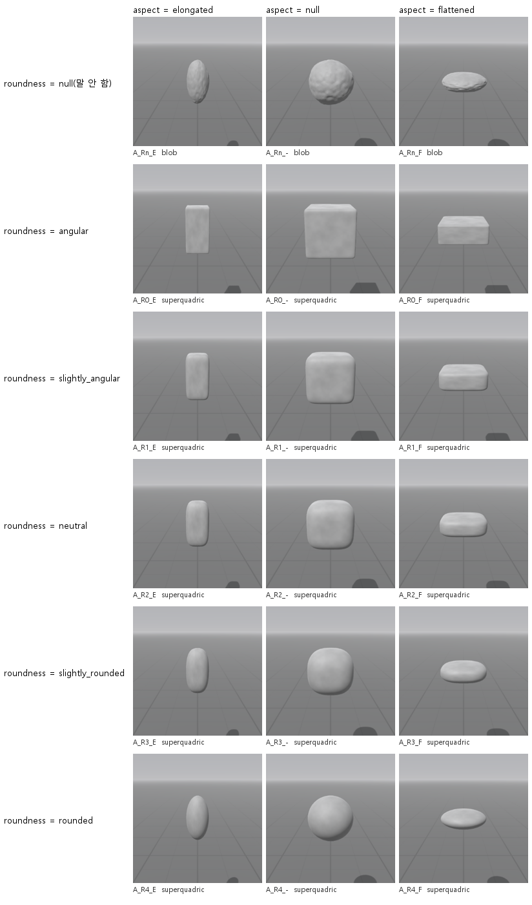
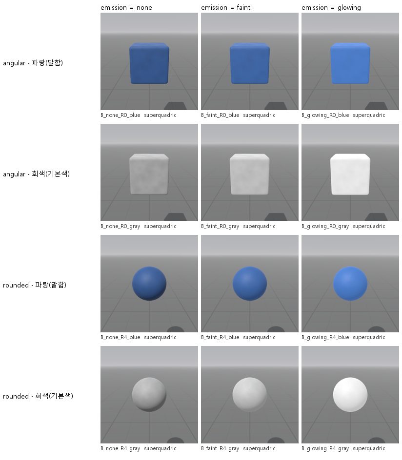

# 스펙 2.3 윤곽·발광 화면 검증 (G61 ①, 2026-11-26)

- Unity가 SceneSpec 2.3.0의 `form.roundness`·`form.aspect`·`material.emission`을 읽고 그린 결과입니다(`docs/scene-spec-mapping.md` 8.4·8.5절).
- spec 30개는 모두 합성입니다(AGENTS.md 6). 뼈대는 매퍼 v2(builder 2.5.0, `ext_lexicon` 켬)가 합성 문장으로 만든 2.3.0 문서이고, 세 슬롯 값과 근거만 바꿔 넣었습니다(`make_specs.py`). `neutral` 단계는 사전이 내지 않아 문장으로 만들 수 없습니다.
- 그림 판정은 **AI(이 작업을 한 에이전트)가 캡처를 직접 열어 본 것**입니다. 팀원 판정과 헤드셋 확인은 하지 않았습니다.
- 캡처: `BatchCapture`(데스크톱 GPU, Built-in 렌더 파이프라인, 중립 환경), 눈당 1032 × 1104, 한 눈, 준비 2 + 10프레임, PNG 폭 768. 시트는 장면 PNG 가운데 300 × 300을 모두 같은 배율로 잘라 붙였습니다(형상마다 확대하는 `_detail.png`로는 크기·비율을 견줄 수 없어서).

| 파일 | 내용 |
| --- | --- |
| `sheets/contour.png` | 둥긂 6행(null + 5단계) × 길쭉함 3열(elongated · null · flattened). 색·발광 없음(기본 회색) |
| `sheets/emission.png` | 발광 3열(none · faint · glowing) × {angular, rounded} × {파랑(말함), 회색(기본색)} |
| `capture/<id>.png` | 시트에 쓴 잘라 낸 PNG |
| `summary.json` | spec마다 renderPath, 기록의 `contour`·`emission`, `defaultsUsed`의 form.* 키, 보이는 화소, 윤곽 지표, 화면 평균색, 콘솔 오류·경고, 모형 삼각형, 프레임시간 p95, 윤곽 관련 notes |

## 1. 결과





| 항목 | 결과 |
| --- | --- |
| 로드·콘솔 | 30/30 로드, 오류 0, 경고 0 |
| 렌더 경로 | 둥긂이 있으면 `superquadric`(24개), 둥긂 null이면 `blob`(6개 — 길쭉함만 있으면 기본 덩어리 메시에 축 배율만) |
| 메시 | 슈퍼쿼드릭 삼각형 2,208(정점 1,106) / 기본 덩어리 5,120 |
| 기록 | 예: angular만 → `contour {status applied, mesh superquadric/1, e1 0.1, e2 0.1, axisRatios null}`, `defaultsUsed`에 `form.aspect`. 길쭉함만 → `mesh default`, `axisRatios [0.5, 1, 0.5]`, `defaultsUsed`에 `form.roundness`·`form.aspect.axis` |
| 발광 none | 화면 평균색이 발광 null과 같음(angular 회색 둘 다 sRGB 159·159·159) — 단위 테스트의 화소 비교(`ContourLoaderTests.Emission_null_or_none_keeps_22_pixels`)와 같은 결과 |
| 프레임시간 | p95 최대 2.1 ms(데스크톱 대리 측정, Quest 아님) |

### 그림을 본 판정(AI, 솔직하게)

| 무엇 | 판정 | 메모 |
| --- | --- | --- |
| 둥긂 5단계 | **단계가 구별됨** | angular는 모서리가 살짝 둥근 정육면체, slightly_angular는 둥근 상자, neutral은 쿠션, slightly_rounded는 덜 둥근 구, rounded는 구로 읽힌다. 이웃 단계(특히 neutral ↔ slightly_rounded)는 작은 크기에서 차이가 작다 |
| 모서리 음영 | **얼룩 없음** | 해석 법선이라 angular(e = 0.1)에서도 모서리 음영이 고르게 이어진다(`capture/A_R0_-.png`). 표면의 얕은 얼룩은 거칠기 얼룩(기본 0.5)이고 정점 변위는 0 |
| 길쭉함·납작함 | **그렇다** | elongated는 세로로 긴 기둥·타원, flattened는 납작한 판·원반. 긴 축 = 1이라 elongated·flattened는 같은 `layout.size`에서 화면 넓이가 둥긂 null의 약 절반이다(예: 7,572 / 7,388 vs 15,724화소) |
| 둥긂 null + 길쭉함 | **그렇다(덩어리 질감 유지)** | 기본 덩어리의 굴곡 노이즈를 그대로 두고 축 배율만 곱해 울퉁불퉁한 타원·납작한 덩어리가 된다 — 말하지 않은 둥긂을 바꾸지 않는다는 규칙대로 |
| 발광 faint | **약함** | 바탕색이 조금 밝아지는 정도라 none과 나란히 놓아야 구별된다 |
| 발광 glowing | **밝게 보이지만 '빛나는' 느낌은 약함** | 블룸이 없어 형상 밖으로 번지지 않는다(명세대로). 회색 기본색 + glowing은 거의 흰색으로 포화돼 음영이 사라진다(바탕색 × 1을 더함). 파랑은 밝은 파랑으로 남는다 |

## 2. 알려진 한계

- 헤드셋에서 보지 않았습니다. 발광은 Quest 디스플레이(밝기·톤)와 주변 환경 밝기에 따라 다르게 보입니다. 블룸·후광이 없어 '빛난다'기보다 '밝다'로 읽힐 수 있습니다.
- 회색 기본색 + glowing은 포화돼 형상 음영(윤곽 읽기)이 약해집니다. 세기 표(0 / 0.35 / 1.0)는 `scene_params.v3.json`의 초안 값입니다.
- 정면 한 방향, 정지 화면만 봤습니다(움직임·조절 중 형태 변경은 테스트로만 확인).
- 윤곽은 형상 전체에만 적용됩니다(8.8절). 모양 모형 낱말과 윤곽어를 함께 말하면 모형이 이깁니다(`not_applied_model`).

## 3. 다시 만들기

```bat
python docs\validation\scene-spec-2.3\make_specs.py <임시>\specs
:: 캡처(make_specs 출력에서 *.json만 남긴 폴더로 — _index.json 제외)
"C:\Program Files\Unity\Hub\Editor\6000.0.85f2\Editor\Unity.exe" -batchmode -projectPath unity -executeMethod IFS.SceneSpec.EditorTools.BatchCapture.Run -specDir <입력> -outDir <캡처> -width 1032 -height 1104 -frames 10 -warmup 2 -eyes 1 -pngWidth 768 -logFile <로그>
:: 모으기(시스템 Python + PIL)
python docs\validation\scene-spec-2.3\collect.py <캡처> <임시>\specs
```

Unity가 `QualitySettings.asset`을 다시 쓰면 `git checkout`으로 되돌립니다.
